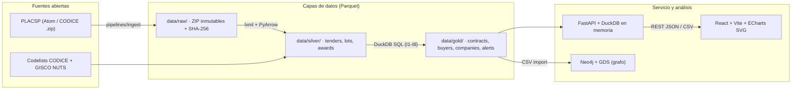

# Riesgos en la contratación pública española

[](https://github.com/adrianfuertes04/riesgos-contratacion-publica/actions/workflows/ci.yml)


Sistema de análisis de datos y visualización interactiva sobre los datos abiertos de la **Plataforma de Contratación del Sector Público (PLACSP)**. Ingesta los feeds Atom/CODICE, los normaliza en capas (`raw → silver → gold`), calcula indicadores estadísticos de riesgo basados en literatura de *red flags* y los expone mediante una API en FastAPI y una aplicación web en React + ECharts.

Trabajo Fin de Máster (Máster en Análisis y Visualización de Datos Masivos, UNIR).

> **Aviso metodológico:** los indicadores calculados son señales estadísticas sobre datos abiertos. No constituyen prueba ni acusación de irregularidad alguna.

---

## Arquitectura

El sistema sigue una arquitectura *medallion* (`raw → silver → gold`) desacoplada del servidor de aplicación: el procesado pesado se resuelve en batch sobre ficheros Parquet y la API sirve consultas analíticas en memoria con DuckDB en menos de 100 ms.



| Capa | Directorio / Módulo | Tecnología | Responsabilidad |
|---|---|---|---|
| **Ingesta (`raw`)** | `pipelines/ingest/` · `data/raw/` | `requests` | Descarga idempotente con reanudación HTTP (`Range`), control de integridad SHA-256 y registro en `manifest.jsonl`. |
| **Normalización (`silver`)** | `pipelines/transform/` · `data/silver/` | `lxml`, `pyarrow`, `duckdb` | Parseo en *streaming* de feeds Atom/CODICE, tipado estricto, deduplicación de versiones por expediente y particionado anual en Parquet. |
| **Indicadores (`gold`)** | `pipelines/indicators/` · `data/gold/` | `duckdb` | Cálculo de los indicadores `I1`–`I8`, puntuaciones de riesgo agregadas, HHI, validación/seudonimización de NIF y tablas listas para consulta. |
| **Grafo** | `pipelines/graph/` | `neo4j` | Exportación de nodos (órganos, empresas, licitaciones, lotes) y relaciones para análisis de red y algoritmos GDS. |
| **API** | `api/` | `FastAPI`, `Pydantic`, `duckdb` | 16 endpoints REST sobre las vistas Parquet de la capa `gold`, con búsqueda, subgrafos y exportación de alertas a CSV. |
| **Frontend** | `frontend/` | `React`, `TypeScript`, `Tailwind`, `ECharts` | Cuadro de mando interactivo, coropletas territoriales, explorador de grafo de fuerzas y fichas de detalle con exportación SVG. |

- Las decisiones de diseño (ADRs) están justificadas en [`docs/decisiones.md`](docs/decisiones.md) y el inventario de fuentes en [`docs/fuentes.md`](docs/fuentes.md).

---

## Indicadores implementados (capa 1)

| Código | Indicador | Nivel | Descripción resumida |
|---|---|---|---|
| **I1** | Único licitador | Contrato | Procedimiento abierto o simplificado con una sola oferta recibida |
| **I2** | Concentración (HHI) | Organismo | Índice de Herfindahl-Hirschman por encima del percentil 95 entre órganos comparables |
| **I3** | Posible fraccionamiento | Contrato | Contratos menores del mismo órgano, empresa y grupo CPV (3 dígitos) que superan el umbral legal en 365 días |
| **I4** | Procedimiento poco competitivo | Contrato | Negociado sin publicidad o tramitación urgente / de emergencia |
| **I5** | Plazo de presentación corto | Contrato | Plazo inferior al percentil 5 de su mismo tipo de procedimiento y contrato |
| **I6** | Precio anómalo | Contrato | Adjudicación al ≥ 99,9 % del presupuesto en concurrencia o baja atípica (< percentil 1) |
| **I7** | Contrato modificado | Contrato | Expediente con anuncios de modificación publicados |
| **I8** | Recurrencia órgano-empresa | Relación | Misma empresa adjudicataria en al menos 3 años distintos para el mismo órgano |

La definición formal, las fuentes normativas y las limitaciones conocidas se detallan en [`docs/indicadores.md`](docs/indicadores.md).

---

## Funcionalidad de la aplicación

- **Panel general (`/`)**: KPIs agregados, evolución mensual, distribución por división CPV, desglose de alertas `I1`–`I8` y rankings de órganos y empresas ordenables por **importe** o por **puntuación de riesgo**.
- **Mapa territorial (`/mapa`)**: coropleta por comunidades autónomas (NUTS 2) y provincias (NUTS 3) con selector de indicador y ficha lateral.
- **Explorador de grafo (`/grafo`)**: red órgano-empresa de 1 o 2 saltos con filtros por año, importe, sector CPV, territorio y riesgo mínimo.
- **Panel de alertas (`/alertas`)**: búsqueda por texto, filtrado por indicador y nivel, ordenación paginada y **exportación a CSV** para auditoría manual.
- **Fichas de detalle**: perfil individual de cada órgano de contratación y cada empresa adjudicataria, con validación de NIF, contrapartes, alertas y contratos.

---

## Puesta en marcha

### Requisitos

- [uv](https://docs.astral.sh/uv/) (gestiona Python 3.12 y las dependencias)
- Node.js 18 o superior
- Opcional: Docker Desktop y [`just`](https://github.com/casey/just)

### Instalación y ejecución local (Windows / PowerShell)

```powershell
uv sync
cd frontend; npm install; cd ..

# 1. Descargar un mes de licitaciones y contratos menores (idempotente)
uv run python -m pipelines.ingest.placsp --dataset licitaciones --periodo 202609
uv run python -m pipelines.ingest.placsp --dataset menores --periodo 202609

# 2. Construir capas silver -> informe de calidad -> gold
uv run python -m pipelines.transform.build_silver
uv run python -m pipelines.quality.report --nombre 202609
uv run python -m pipelines.indicators.build_gold

# 3. Levantar API (http://localhost:8000/docs) y frontend (http://localhost:5173)
uv run uvicorn api.main:app --reload
cd frontend; npm run dev
```

Con `just` instalado: `just pipeline 202609`, `just api`, `just web`, `just test`.

### Con Docker

```powershell
docker compose up -d --build
```

Levanta la API y el frontend en `http://localhost:8080`. Para el grafo en Neo4j: `docker compose up -d neo4j` seguido de `pipelines.graph.export_neo4j` y `pipelines.graph.load_neo4j`.

---

## Calidad y tests

```powershell
uv run pytest
uv run ruff check .
uv run ruff format --check .
uv run mypy
cd frontend; npm run typecheck; npm run build
```

---

## Estructura del repositorio

```text
├── api/                 # API FastAPI sobre DuckDB (endpoints, modelos Pydantic)
├── docs/                # Documentación, ADRs, bitácora, indicadores y calidad
├── frontend/            # Aplicación web React + TypeScript + Vite + ECharts
├── notebooks/           # Notebooks de exploración (formato percent)
├── pipelines/
│   ├── ingest/          # Descarga PLACSP (y esqueletos BORME / pliegos)
│   ├── transform/       # Parser CODICE y construcción de silver
│   ├── quality/         # Validación/seudonimización de NIF e informes
│   ├── indicators/      # Parámetros e indicadores I1-I8 (gold)
│   ├── graph/           # Exportación CSV y carga en Neo4j
│   ├── llm/             # Esquemas iniciales de extracción sobre pliegos
│   └── reference/       # Listas de códigos CODICE y geometrías NUTS
├── tests/               # Suite pytest (parser, NIF, ingesta, indicadores, API)
└── data/                # raw / silver / gold (no versionado)
```

---

## Estado y hoja de ruta

- **Hecho (fase 0):** pipeline completo de capa 1 probado con datos reales de PLACSP (`09/2026`: 82.769 contratos, 25.901 alertas), API FastAPI, aplicación web y suite de 40 tests.
- **En curso / pendiente:** descarga del histórico completo (incluyendo sindicación `1044` de plataformas autonómicas), calibración de `I6` y contratos menores, y contraste de umbrales con informes de OIReScon y CNMC.

El seguimiento detallado está en [`docs/estado.md`](docs/estado.md) y [`docs/bitacora.md`](docs/bitacora.md).

## Licencia

Código bajo licencia [MIT](LICENSE). Los datos proceden de fuentes abiertas del sector público y conservan su licencia de origen (ver [`docs/fuentes.md`](docs/fuentes.md)). Límites administrativos © EuroGeographics.
